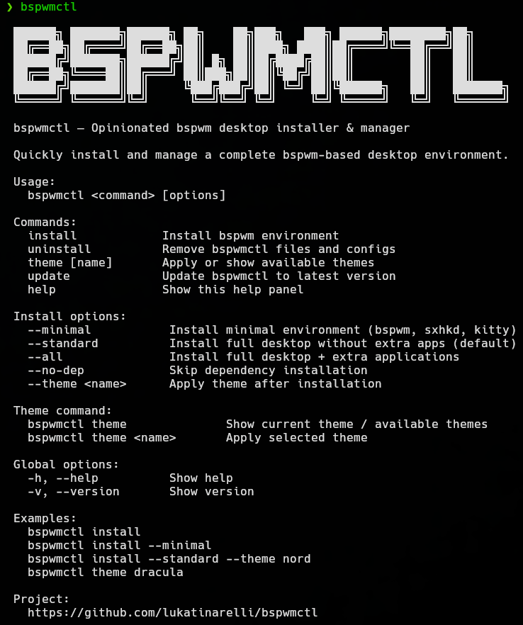

<div align="center">
  

  # bspwmctl – Opinionated bspwm desktop setup

  Create and manage a fully configured bspwm environment using a simple CLI.

  
  
  <a href="https://github.com/bspwmctl/bspwmctl/blob/main/LICENSE">
    </a>
  
  <a href="https://github.com/bspwmctl/bspwmctl/releases/tag/v0.2.0-beta.1">
    </a>
  
  
  
  
    
  <a href="https://github.com/baskerville/bspwm">
  </a>

  ---

  

  <em>by lukatinarelli</em>
</div>

## 📑 Table of Contents

1. [Introduction](#%EF%B8%8F-introduction)
2. [Features](#-features)
3. [Supported Distributions](#-supported-distributions)
4. [Quick Start](#-quick-start)
5. [Installation Modes](#-installation-modes)
6. [Usage](#-usage)
7. [What Gets Installed](#-what-gets-installed)
8. [Roadmap](#-roadmap)
9. [Contributing](#-contributing)
10. [License](#-license)

---

## 🏗️ Introduction

**bspwmctl** is an automated installer and manager for [bspwm](https://github.com/baskerville/bspwm)-based desktop environments. It simplifies the process of setting up a complete, opinionated bspwm workflow with all necessary tools and configurations.

Whether you're setting up a new system or want to try bspwm without manual configuration hell, bspwmctl does the heavy lifting for you.

> ⚠️ **This is a v0.2.0 beta release.** Core functionality works, but some features are still under development. See the [Roadmap](#-roadmap) for what's coming next.

---

## ✨ Features

- 🚀 **One-command installation** of a complete bspwm desktop
- 📦 **Official packages only**: everything is installed with `apt`, `pacman` or `dnf`, nothing is compiled
- 🐧 **Multi-distro support** (Debian, Ubuntu, Arch, Fedora, and derivatives)
- 🧱 **Three installation modes** (minimal, standard, full)
- 🎨 **Pre-configured setup** ready to use out of the box
- 💾 **Automatic backups** of your configs before anything is overwritten
- 🎭 **Theme system** (coming soon)

---

## 🐧 Supported Distributions

| Distribution Family | Tested On | Should also work on |
|---------------------|-----------|---------------------|
| **Debian-based**    | Debian 13, Ubuntu 24.04 | Kali, Parrot, Linux Mint, Pop!_OS... |
| **Arch-based**      | Arch Linux | Manjaro, EndeavourOS, Garuda... |
| **Fedora-based**    | Fedora | Nobara... |

Derivatives are detected automatically; bspwmctl warns you when your distro hasn't been tested yet.

---

## 🚀 Quick Start

### Prerequisites

- A fresh or existing Linux installation (see supported distros above)
- **Do NOT run as root** – use a normal user with sudo privileges
- Active internet connection

### Installation

Download the package for your distro from the [latest release](https://github.com/bspwmctl/bspwmctl/releases/latest) and install it:

```bash
# Debian / Ubuntu / Kali / Parrot
sudo apt install ./bspwmctl_*_all.deb

# Fedora
sudo dnf install ./bspwmctl-*.noarch.rpm

# Arch / Manjaro / EndeavourOS
sudo pacman -U ./bspwmctl-*-any.pkg.tar.zst

# Then, as your normal user
bspwmctl install
```

Or run it straight from the repository:

```bash
# Clone the repository
git clone https://github.com/bspwmctl/bspwmctl.git
cd bspwmctl

# Make the script executable
chmod +x bspwmctl

# Run the installer
./bspwmctl install
```

That's it! The script will:
1. Detect your distribution
2. Install bspwm and the rest of the desktop from your distro's official packages
3. Set up configurations in `~/.config/`

### Post-Installation

1. Log out of your current session
2. At the login screen, select **BSPWM** as your session
3. Log in and enjoy your new desktop environment!

---

## 📦 Installation Modes

bspwmctl offers three installation modes to fit your needs:

### 🔹 Minimal (Default)
```bash
./bspwmctl install --minimal
```
**Installs:**
- bspwm (window manager)
- sxhkd (hotkey daemon)
- kitty (terminal emulator)
- rofi (application launcher)
- feh (wallpaper)

Perfect for: Users who want just the essentials or plan to customize heavily.

---

### 🔸 Standard
```bash
./bspwmctl install --standard
```
**Installs everything from Minimal, plus:**
- Polybar (status bar)
- Picom (compositor for transparency/effects)
- Dunst (notifications)
- i3lock (screen locker)
- Flameshot (screenshots)
- Volume and brightness keys (pactl, brightnessctl), pavucontrol
- Polkit agent (password prompts for graphical apps), clipboard tool, Papirus icons
- Zsh with autosuggestions and syntax highlighting, set as your default shell (an existing `~/.zshrc` is backed up)

Perfect for: Most users who want a complete desktop experience.

---

### 🔶 Full
```bash
./bspwmctl install --all
```
**Installs everything from Standard, plus:**
- Thunar (file manager) – `super + e`
- Firefox – `super + shift + f` (Firefox ESR on Debian; on Ubuntu the preinstalled snap is used)
- btop (system monitor), mpv (video player), zathura (PDF viewer)
- NetworkManager connection editor

Perfect for: A complete desktop ready to use.

---

## 📖 Usage

```bash
# Show help panel
bspwmctl
bspwmctl help

# Install with default settings (minimal mode)
bspwmctl install

# Install standard environment
bspwmctl install --standard

# Install everything, including extra apps
bspwmctl install --all

# Only apply the configs, without installing packages (advanced)
bspwmctl install --no-dep

# Show current theme and available themes
bspwmctl theme

# Re-apply the default configs
bspwmctl theme default

# List / restore config backups
bspwmctl restore
bspwmctl restore <backup>

# Check version
bspwmctl --version
```

---

## 🛠️ What Gets Installed

Everything is installed from your distribution's official repositories (apt, pacman or dnf), so it is updated and removed like any other package.

### Core Components

| Component | Purpose | Repository |
|-----------|---------|------------|
| **bspwm** | Tiling window manager | [baskerville/bspwm](https://github.com/baskerville/bspwm) |
| **sxhkd** | Hotkey daemon | [baskerville/sxhkd](https://github.com/baskerville/sxhkd) |
| **kitty** | GPU-accelerated terminal | [kovidgoyal/kitty](https://github.com/kovidgoyal/kitty) |
| **Rofi** | Application launcher | [davatorium/rofi](https://github.com/davatorium/rofi) |
| **Polybar** | Customizable status bar | [polybar/polybar](https://github.com/polybar/polybar) |
| **Picom** | Compositor | [yshui/picom](https://github.com/yshui/picom) |
| **Dunst** | Notifications | [dunst-project/dunst](https://github.com/dunst-project/dunst) |

### Keybindings

| Keys | Action |
|------|--------|
| `super + Return` | Terminal |
| `super + d` | App launcher |
| `super + l` | Lock screen |
| `super + w` | Close window |
| `Print` / `shift + Print` | Screenshot (area / full screen) |
| `super + alt + q` / `r` | Quit / restart bspwm |

See `~/.config/sxhkd/sxhkdrc` for the full list.

### File Locations

Bundled fonts are installed to `~/.local/share/fonts/bspwmctl/`, and the current theme is stored in `~/.local/share/bspwmctl/`.

User configurations are copied to:
```
~/.config/
├── bspwm/
├── sxhkd/
├── kitty/
├── polybar/
├── picom/
└── dunst/
```

Files that would be overwritten are backed up first to `~/.local/share/bspwmctl/backups/<date>/`:

```bash
bspwmctl restore            # list backups
bspwmctl restore <date>     # restore one
```

To set a wallpaper, place an image at `~/.config/bspwm/wallpaper.png` (or `.jpg`).

---

## 🗺️ Roadmap

### v0.1.0 ✅
- [x] Multi-distro support (Debian, Arch, Fedora families)
- [x] Minimal and Standard installation modes
- [x] Basic bspwm + sxhkd + kitty setup
- [x] Polybar and Picom integration
- [x] Session entry creation

### v0.2.0 (In progress – beta available)
- [x] Install from official distro packages (no compiling)
- [x] `.deb`, `.rpm` and Arch packages on every release
- [x] Full installation mode with extra applications
- [x] Notifications, lock screen, screenshots, media keys
- [x] Zsh integration
- [x] Configuration backup/restore
- [ ] Powerlevel10k
- [ ] Theme system implementation
- [ ] `bspwmctl update` command
- [ ] `bspwmctl uninstall` command

### v0.3.0+ (Future)
- [ ] External theme repository support
- [ ] Plugin/script system
- [ ] GUI theme picker
- [ ] Dotfiles sync

See the [issues page](https://github.com/bspwmctl/bspwmctl/issues) for more details and to suggest features.

---

## 🤝 Contributing

Contributions are welcome! This is an open-source project and we'd love your help making it better.

Please read [CONTRIBUTING.md](CONTRIBUTING.md) for:
- How to report bugs
- How to suggest features
- How to contribute code
- Code guidelines

---

## 📄 License

This project is licensed under the [MIT License](../LICENSE).

---

## 💬 Support

- 🐛 **Found a bug?** [Open an issue](https://github.com/bspwmctl/bspwmctl/issues/new?labels=bug)
- 💡 **Have an idea?** [Request a feature](https://github.com/bspwmctl/bspwmctl/issues/new?labels=enhancement)
- ❓ **Questions?** [Ask in Discussions](https://github.com/bspwmctl/bspwmctl/discussions)
- 📖 **Documentation:** [bspwmctl.github.io/docs](https://bspwmctl.github.io/docs/)

---

<div align="center">
  <sub>Built with ❤️ by <a href="https://github.com/lukatinarelli">lukatinarelli</a></sub>
</div>


